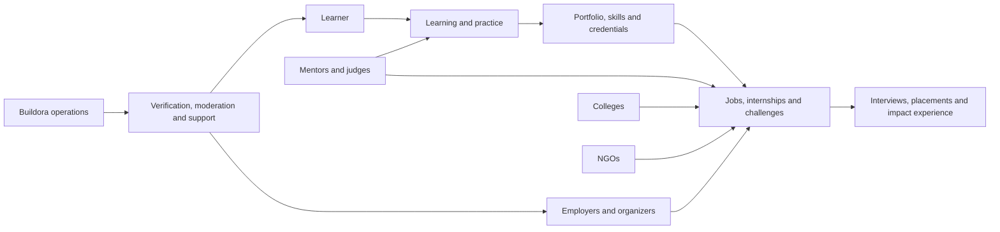

# Buildora — Full Platform Plan

**Status:** Planning document  
**Source:** Complete feature, screen, and page plan derived from `BUILDORA_PRD.md`  
**Scope:** The complete Buildora platform, beyond the MVP

## 1. Product map

Buildora is a multi-sided platform where learners build evidence of ability and use it to access opportunities. Employers, organizers, colleges, NGOs, and mentors create the opportunities, programs, feedback, and outcomes that make the learner profile valuable.

### 1.1 Primary workspaces

| Workspace | Primary users | Purpose |
| --- | --- | --- |
| Public site | Everyone | Explain Buildora, acquire users, publish editorial content, capture partnership leads |
| Learner workspace | Students, graduates, career switchers | Learn, practice, build proof, discover, apply, participate, book mentoring |
| Organization workspace | Employers, organizers, NGOs, colleges, communities | Verify the organization, publish programs, run selection and review outcomes |
| College workspace | Authorized college staff | Manage institution profile, cohorts, restricted programs, placements, aggregate reporting |
| Mentor workspace | Approved mentors | Configure services, availability, bookings, delivery, feedback, payouts |
| Judge workspace | Event evaluators | Review assigned submissions, score with a rubric, record feedback |
| Operations workspace | Buildora admins and support staff | Trust, moderation, content, disputes, platform configuration, reporting |

### 1.2 Shared platform capabilities

- Authentication, account recovery, identity verification, and multi-role switching.
- Role-based access control, organization membership, audit logs, and consent records.
- Universal search, filters, saved items, notifications, activity history, and help/support.
- Billing, invoices, refunds, taxes, payment collection, mentor payout processing, and entitlements.
- CMS, asset library, taxonomy, SEO pages, email templates, and campaign tracking.
- Reporting, exports, privacy controls, data retention, moderation, and abuse reporting.

## 2. Information architecture and route inventory

Routes are illustrative. Final URL naming can change, but each distinct row represents a required page or screen.

### 2.1 Public pages

| Area | Pages / routes | Core purpose and content |
| --- | --- | --- |
| Home | `/` | Product promise, role entry points, featured opportunities, learning paths, NGO impact program, social proof, plans, CTA |
| Opportunity discovery | `/opportunities`, `/hackathons`, `/internships`, `/jobs`, `/competitions`, `/assessments` | Filterable directories, saved search, featured content, clear eligibility and deadlines |
| Opportunity details | `/opportunities/:slug` | Overview, organizer, schedule, eligibility, benefits, FAQs, rules, resources, application/registration CTA |
| Hackathon marketing | `/hackathons` | Explain formats, showcase programs and winners, guide organizers and participants |
| Internship marketing | `/internships` | Explain direct applications, credible internships, profile evidence, employer publishing CTA |
| Careers marketing | `/careers` | Employer talent solution, workflow, customer proof, organization sign-up CTA |
| Skills marketing | `/skills`, `/learning-paths` | Course catalog pitch, tracks, credentials, learner outcomes |
| Resources | `/resources`, `/resources/:slug` | Guides, templates, tutorials, videos, tools, category/filter/search pages |
| News | `/news`, `/news/:slug`, `/newsletter` | Searchable editorial posts, newsletter subscription, author/category pages |
| Mentorship | `/mentors`, `/mentors/:slug`, `/become-a-mentor` | Mentor discovery, services, trust signals, booking CTA, mentor application |
| Partnerships | `/partners`, `/partners/inquire`, `/partners/ngo`, `/partners/college`, `/partners/corporate` | Partnership propositions, NGO challenge program, inquiry form, case studies |
| Colleges | `/colleges` | College workspace value, placement/outcomes reporting, staff inquiry CTA |
| Plans | `/pricing`, `/pricing/learners`, `/pricing/organizers`, `/coaching` | Plan comparison, FAQs, billing terms, upgrade CTA |
| Organizations | `/organizations/:slug` | Verified organization profile, open programs, past programs, resources, follow/contact actions |
| Credentials | `/verify/:credentialId` | Public minimal credential verification and current status |
| Help and contact | `/help`, `/contact`, `/status` | Help center, support request, system status |
| Legal and trust | `/terms`, `/privacy`, `/cookies`, `/community-guidelines`, `/refund-policy`, `/accessibility`, `/trust-and-safety` | Required terms, policies, reporting process, data rights |
| Authentication | `/sign-in`, `/sign-up`, `/forgot-password`, `/reset-password`, `/verify-email` | Entry, account recovery, email verification, social sign-in |

### 2.2 Learner workspace pages

| Area | Pages / routes | Required screens and functions |
| --- | --- | --- |
| Onboarding | `/onboarding/*` | Role selection, segment, goal, education/experience, location, skills, interests, availability, consent, recommendations preview |
| Dashboard | `/app` | Deadlines, applications, registrations, course progress, mentor activity, recommendations, profile completion, announcements |
| My profile | `/app/profile`, `/u/:handle` | Edit personal details, public profile preview, visibility controls, share link |
| Skills and evidence | `/app/profile/skills`, `/app/profile/projects`, `/app/profile/credentials`, `/app/profile/outcomes` | Add/edit evidence, verification status, project contribution, certificate list, placement/impact experience record |
| Resume | `/app/resume` | Resume upload, parsed fields review, profile-to-resume export, version management |
| Discover | `/app/discover` | Personalized opportunities, courses, mentors, resources; search and filters |
| Saved items | `/app/saved` | Saved jobs, internships, events, courses, mentors, searches |
| Applications | `/app/applications`, `/app/applications/:id` | Drafts, submitted applications, stage timeline, messages, interview requests, withdrawal where allowed |
| Event hub | `/app/events`, `/app/events/:eventSlug` | Registrations, current round, checklist, schedule, team, resources, submissions, results |
| Team workspace | `/app/events/:eventSlug/team` | Create/join team, invitations, member roles, team eligibility, team chat/contact settings |
| Submission workspace | `/app/events/:eventSlug/submission` | Autosaved project/case entry, files/URLs/repository/demo/presentation, receipt, status, feedback |
| Assessments | `/app/assessments`, `/app/assessments/:attemptId` | Invitations, instructions/consent, assessment runner, timer, submission confirmation, results/feedback where permitted |
| Learning | `/app/learn`, `/app/learn/courses/:slug`, `/app/learn/paths/:slug` | Catalog, course player, lessons, progress, graded work, path milestones, certificate claim |
| Practice | `/app/practice`, `/app/practice/mock-tests/:slug`, `/app/practice/interview-prep` | Role-based mock tests, score reports, recommendations, portfolio prompts, interview question practice |
| Mentors | `/app/mentors`, `/app/mentors/:slug`, `/app/mentorship/book/:id` | Search, availability, mentor profile, booking, checkout, session agenda, feedback |
| Messages and notifications | `/app/notifications`, `/app/messages` | Actionable notifications, organization/session messages, preferences entry point |
| Billing | `/app/billing`, `/app/billing/checkout`, `/app/billing/invoices` | Plan, add-ons, payment methods, invoices, cancellation, upgrade/downgrade |
| Settings | `/app/settings/profile`, `/app/settings/privacy`, `/app/settings/notifications`, `/app/settings/security`, `/app/settings/data` | Account, visibility, recruiter discovery consent, notification channels, password/social accounts, export/delete request |
| Support | `/app/support`, `/app/reports/new` | Support cases, report abuse/listing/content, status of submitted reports |

### 2.3 Organization workspace pages

| Area | Pages / routes | Required screens and functions |
| --- | --- | --- |
| Organization onboarding | `/org/onboarding/*` | Organization type, legal entity, address, domain, representative, documents, review status |
| Organization dashboard | `/org` | Publishing queue, application/event pipeline, deadlines, metrics, account tasks, team activity |
| Organization profile | `/org/profile`, `/org/public-preview` | Brand assets, description, website, public contact, verified status, public page preview |
| Team and roles | `/org/team`, `/org/team/invitations`, `/org/roles` | Invite members, assign scoped roles, revoke membership, ownership and billing control |
| Programs | `/org/programs`, `/org/programs/new`, `/org/programs/:id/edit` | Create job, internship, challenge, event, assessment, workshop, scholarship, campaign; drafts and publishing review |
| Program operations | `/org/programs/:id/overview`, `/rounds`, `/participants`, `/teams`, `/submissions`, `/judges`, `/communications`, `/results` | Run competition rounds, manage participation, team formation, submission review, judging, result publication |
| Job/internship hiring | `/org/opportunities/:id/applications`, `/candidates/:id`, `/pipeline`, `/interviews` | Candidate list/detail, filters, notes, assignments, stages, assessment/interview outcomes, messages, decision records |
| Assessments | `/org/assessments`, `/org/question-banks`, `/org/assessments/:id` | Build assessments, manage questions, invitations, integrity rules, monitoring/review, score reports |
| Event scheduling | `/org/programs/:id/schedule`, `/venues`, `/check-in` | Session agenda, venue/capacity, onsite attendance, hybrid participation, QR/manual check-in |
| Content and audience | `/org/content`, `/org/communities`, `/org/campaigns`, `/org/leads` | Branded content, opt-in community, campaigns, consented lead capture, source attribution |
| Analytics and reports | `/org/analytics`, `/org/programs/:id/analytics`, `/org/exports` | Reach, registrations, participation, candidate conversion, hiring/outcomes, event metrics, exports |
| Billing | `/org/billing`, `/org/billing/invoices`, `/org/billing/plan` | Organizer subscription, plan limits, payment method, invoices, upgrades |
| Integrations | `/org/integrations` | Calendar, video, ATS, CRM, webhooks, imports/exports, API credentials where plan allows |
| Trust and support | `/org/verification`, `/org/reports`, `/org/support` | Verification evidence/status, reports, support cases, policy acknowledgement |

### 2.4 College workspace pages

| Area | Pages / routes | Required screens and functions |
| --- | --- | --- |
| Institution setup | `/college/onboarding`, `/college/profile` | Institution verification, campuses, departments, placement contacts, branding |
| College dashboard | `/college` | Cohort status, campus opportunities, placement activity, upcoming events, aggregate outcomes |
| Staff and permissions | `/college/team` | Authorized placement staff, faculty, club/festival committee permissions |
| Cohorts and eligibility | `/college/cohorts`, `/college/cohorts/:id` | Cohort creation/import, fields, consent, eligibility criteria, members, archive/export |
| Campus programs | `/college/programs`, `/college/programs/new`, `/college/programs/:id` | Campus-restricted opportunities/events, invitations, nominations, participation and selection tracking |
| Student outcomes | `/college/outcomes`, `/college/reports` | Aggregate applications, interviews, placements, certificates, verified impact experience; privacy-safe exports |
| Community pages | `/college/communities`, `/college/communities/:id` | Student club or festival pages, scoped program management, public presence |

### 2.5 NGO workspace pages

| Area | Pages / routes | Required screens and functions |
| --- | --- | --- |
| NGO verification | `/ngo/onboarding`, `/ngo/verification` | Nonprofit/legal registration, representative, domain, safeguarding acknowledgement, review status |
| NGO dashboard | `/ngo` | Active impact briefs, challenge progress, intern pipeline, impact verification tasks, support |
| Impact brief builder | `/ngo/impact-briefs`, `/ngo/impact-briefs/new`, `/ngo/impact-briefs/:id` | Community context, beneficiaries, goals, constraints, safe data rules, IP, evaluation, implementation/internship pathway |
| NGO challenge operations | `/ngo/challenges/:id` | Program setup, resources, participant communications, review, shortlist, solution handover controls |
| NGO internships | `/ngo/internships`, `/ngo/internships/new`, `/ngo/internships/:id/applications` | Internship disclosure, applications, supervision, pipeline, candidate selection |
| Impact verification | `/ngo/impact-experiences`, `/ngo/impact-experiences/:id` | Confirm role, dates, scope, public learner-approved summary, restricted evidence |
| NGO reporting | `/ngo/analytics`, `/ngo/reports` | Participation, solution quality, internship conversion, implementation milestones, privacy-safe outcomes |

### 2.6 Mentor, judge, and admin pages

| Workspace | Pages / routes | Required screens and functions |
| --- | --- | --- |
| Mentor | `/mentor/onboarding`, `/mentor`, `/mentor/services`, `/mentor/availability`, `/mentor/bookings`, `/mentor/bookings/:id`, `/mentor/payouts`, `/mentor/reviews` | Application/review, service setup, calendar, booking delivery, feedback, payout/KYC, reputation |
| Judge | `/judge`, `/judge/assignments/:id`, `/judge/scorecards/:id` | Assigned submission queue, evidence viewer, rubric scoring, comments, conflicts disclosure, submit/finalize |
| Admin dashboard | `/admin` | Trust queue, service health, operational KPIs, priority tasks |
| Verification admin | `/admin/verifications`, `/admin/verifications/:id` | Organization, NGO, mentor, college, credential and outcome verification; reviewer notes and decisions |
| Moderation admin | `/admin/moderation`, `/admin/reports`, `/admin/users/:id` | Listing/content review, report investigations, user enforcement, appeals, audit trails |
| Program admin | `/admin/programs`, `/admin/rounds`, `/admin/results` | Intervention controls, schedule overrides, result disputes, launch support |
| Assessment admin | `/admin/question-banks`, `/admin/integrity`, `/admin/reviews` | Question governance, suspicious attempt review, similarity flags, scoring escalation |
| Learning CMS | `/admin/courses`, `/admin/paths`, `/admin/resources`, `/admin/news` | Course authoring, lesson assets, grading criteria, credential versions, editorial workflow |
| Payments admin | `/admin/payments`, `/admin/refunds`, `/admin/payouts`, `/admin/disputes` | Subscription transactions, refunds, mentor payout exceptions, reconciliation, disputes |
| Taxonomy and configuration | `/admin/taxonomy`, `/admin/feature-flags`, `/admin/templates`, `/admin/notifications` | Skills, categories, locations, eligibility types, configurable templates, notification rules |
| Analytics and audit | `/admin/analytics`, `/admin/audit-logs`, `/admin/exports` | Platform funnels, quality metrics, immutable sensitive-action history, governed exports |

## 3. Feature plan by product domain

### 3.1 Identity, account, and access

**Features**

- Email/password sign-up, Google, GitHub, and LinkedIn authentication.
- Email verification, password reset, session/device management, optional MFA.
- Multi-role account model with one active workspace and fast switching.
- Learner onboarding for college students, recent graduates, and career switchers.
- Organization membership and scoped permissions: owner, billing administrator, hiring manager, event manager, evaluator, content editor, analyst, and read-only viewer.
- Consent capture for recruiter discovery, marketing, program communications, assessment monitoring, and data processing.
- Account data export, deletion request, retention rules, and legal hold support.

**Critical states**

- New account, incomplete onboarding, verified email, suspended account, deleted-account request, invitation pending, organization membership removed.
- Permission denied, expired invitation, unverified publisher, unavailable social-provider account, recovery in progress.

### 3.2 Learner profile, portfolio, and evidence

**Features**

- Public/private learner profile with handle, avatar, bio, location, education, experience, target roles, skills, and availability.
- Skill records clearly distinguished as self-declared, in review, verified, expired, revoked, or superseded.
- Project portfolio with creator attestation, role on team projects, technologies, repository, demo, assets, related event, and verification evidence.
- Resume upload, parsing/review, downloadable versions, and profile-based export.
- Buildora certificates, external credential verification, and a public credential checker.
- Outcome timeline with applications, offers, verified placements, NGO impact experience, certificates, and event results.
- Recruiter-discovery visibility, profile sharing controls, project-level privacy, and anonymous public verification when appropriate.

**Verification workflows**

1. Learner submits project, credential, or outcome evidence.
2. Automated checks validate required fields, link reachability, issuer/credential format, and duplicate/similarity signals.
3. A reviewer receives flagged, high-impact, or manual-review records.
4. The reviewer approves, rejects, or asks for changes with a reason.
5. The learner sees the state and may appeal where policy permits.

### 3.3 Opportunity marketplace and applications

**Features**

- One opportunity model with type-specific fields for job, internship, hackathon, challenge, competition, assessment, workshop, webinar, conference, festival, scholarship, and campaign.
- Search, typeahead, location/remote filter, skills, compensation/stipend, duration, eligibility, format, dates, organization, difficulty, and registration/application status filters.
- Saved opportunities, saved searches, recommended listings, alerts, and share links.
- Detail pages with structured requirements, schedule, benefits, responsible-use/IP terms, FAQs, organizer trust information, and accessible application actions.
- Native application form using profile/resume, required questions, document uploads, autosave, draft, submit, withdraw policy, status timeline, and notifications.
- Employer pipeline with configurable stages, notes, tags, assignments, search/filter, candidate comparison, bulk actions, messaging, interview scheduling, and CSV export.
- Candidate consent for discoverability and employer access logging.

**Application statuses**

`Draft → Submitted → Under review → Assessment → Interview → Offer / Rejected / Withdrawn / Closed`.

Each organization can rename intermediate stages, but Buildora retains normalized analytics mappings.

### 3.4 Competition, event, and challenge engine

**Supported formats**

- Online, in-person, and hybrid events.
- Individual and team participation.
- Hackathons, NGO innovation challenges, case competitions, project competitions, quizzes, coding screens, workshops, webinars, conferences, cultural events, college festivals, scholarships, and campaigns.

**Organizer builder**

- Event basics, branding, organizer contacts, eligibility, schedule/time zones, venue/capacity/check-in, prizes, terms, FAQ, registration limits, waitlist, and communications.
- Problem statements with resource attachments, data access terms, intellectual-property terms, and responsible-use rules.
- Team rules: size, formation deadline, invite/join policy, leader controls, eligibility recheck, team change policy.
- Ordered rounds with opening/closing window, instructions, advancement rule, contact owner, attachments, visibility, and participant requirements.
- Round modes: registration, assessment, submission, external completion import, live evaluation, manual shortlist, leaderboard, waitlist, disqualification.
- Judges, mentors, rubrics, submission assignments, score normalization, tie-break rules, conflicts disclosures, feedback policy, result publication.
- Timeline, announcements, email/in-product reminders, results, certificates, data export, post-event survey, and archive.

**Participant event hub**

- Current required action and deadline visible above all other content.
- Registration confirmation, eligibility state, team, schedule, resources, submissions, assessment attempts, feedback, results, certificates, and support.
- Receipt for every registration, assessment completion, and submission.

### 3.5 Assessment, screening, and interview service

**Features**

- Role/skill/difficulty-tagged question bank with authorship, versioning, review, retirement, and organization-private content.
- Multiple-choice, multiple-select, situational judgment, coding, case/design/project prompts, file/URL/repository submissions, and live scorecard rounds.
- Assessment templates, test configuration, audience/invitations, start/end windows, attempts, time limit, passing threshold, feedback visibility, and accommodations.
- Assessment runner with server-authoritative timer, autosave, navigation policy, accessibility controls, submission receipt, and interruption recovery.
- Auto-scoring for supported questions/coding and manual evaluation queues for cases/projects and exceptions.
- Integrity controls: verified email/phone, eligibility declaration, randomization, question pools, duplicate prevention, activity/audit events, disclosed device/IP/tab-focus signals, similarity checks, repository-history review, and human review.
- No automatic sanction from behavioral signals. Reviewers record evidence, decision, and participant-facing reason for disqualification where applicable.
- Interview scheduling through availability collection, calendar/video links, interviewer assignment, structured scorecard, private notes, recommendation, candidate feedback, and pipeline updates.

### 3.6 Learning, resources, and career preparation

**Features**

- Proprietary Buildora course catalog, course detail, lesson player, modules, progress, content completion rules, graded activities, and accessibility support.
- Learning-path builder with ordered courses/projects, prerequisites, progress map, milestone badges, and certificate eligibility.
- Course authoring for internal and contracted partner authors, with co-branding, content review, versions, publish/archive dates, and rights management.
- Resource hub for guides, tutorials, videos, templates, and tools with search, filters, tags, estimated effort, bookmark, share, and editorial review.
- First-Time Hacker, Product Builder, and AI Innovator paths, followed by role-based paths driven by demand data.
- Role-based mock tests, score reports, learning recommendations, portfolio prompts, interview preparation, resume checklist, and AI feedback within fair-use limits.
- Completion certificates with unique ID, course/path version, issuer, issue date, current status, and privacy-safe public verification page.

### 3.7 Mentorship marketplace and coaching

**Features**

- Mentor application, identity/experience review, expertise, languages, public bio, links, services, duration, delivery mode, price/free status, standards acknowledgement, availability, and KYC/payout setup.
- Mentor discovery by expertise, language, availability, rating, format, price, and goal.
- Booking flow with session selection, learner context, total price/taxes, cancellation terms, refund terms, payment, confirmation, calendar/video details, and reminders.
- Mentor dashboard for booking queue, schedule overrides, service setup, session history, attendance, feedback, ratings, payout balance, invoices, and availability pause.
- Learner session workspace with agenda, pre-session context, attendance, action notes, rating, dispute/refund request, and history.
- Platform-managed collection, cancellation/no-show rules, refunds/partial refunds, dispute window, payout release after completion, fee calculation, payout reconciliation, tax records, and receipt issuance.
- Career Coaching add-on checkout and controlled monthly Pro credit allocation.

### 3.8 Organization, employer, and brand growth tools

**Features**

- Legal organization verification, representative authorization, domain validation, trust-and-safety screening, re-verification, and trust badge state.
- Public organization profile with logo, description, verified indicator, open opportunities, past programs, resources, moderated reviews, interview experiences, follow/contact options.
- Direct opportunity publication, templates, drafting, internal approvals, preview, scheduling, edits, pause/close/archive, and moderation review.
- Talent community pages, opt-in campaign capture, consented leads, branded content, event promotion, and campaign attribution.
- Source → screen → assess → interview → hire journey with shared candidate data and reporting.
- Standard and premium organizer entitlements, plan limits, billing, invoices, integrations, promoted listings/reach, dedicated-support channel.
- Analytics for reach, traffic source, registration, application, qualified candidate, assessment, interview, offer, hire, and event completion conversion.

### 3.9 College and community platform

**Features**

- College verification, public institution page, campus/departments, staff membership, placement contacts, and institution-level roles.
- Cohort setup through manual entry, template import, eligibility rules, consent capture, status, archival, and export.
- Campus-restricted opportunities, student nominations, program registration, participation tracking, selection visibility, and placement reporting.
- Aggregate outcomes dashboard for applications, interviews, placements, certifications, challenge submissions, and verified NGO impact experience.
- Student club/festival committee organization profiles with constrained event-management permissions.
- Voluntary ambassador cohort: application, onboarding materials, approved campaigns, task proof, staff review, public badge/verified certificate/recommendation letter where earned, learning/event access, removal controls.
- No cash, commission, cash equivalent, placement promises, or paid reward ledger for ambassadors.

### 3.10 NGO impact program

**Features**

- NGO registration and verification including nonprofit/charity evidence where applicable.
- Impact brief builder: community context, beneficiaries, success measures, constraints, resources, data rules, responsible-use rules, IP, evaluation rubric, implementation path, and internship pathway.
- Internal Buildora safety/feasibility review before publication, including privacy, harmful-data, participant-work exploitation, and implementation-claim checks.
- NGO-branded challenge/hackathon program with projects, judging, solution review, collaboration resources, and constrained solution handover.
- Related internship listing on the same NGO profile with pay/stipend/unpaid disclosure, duration, supervision, location, hours, learning outcomes, legal eligibility, and application workflow.
- Explicit learner journey: impact brief → challenge → project evidence → internship application → confirmed impact experience.
- Authorized NGO confirmation of role, dates, and completed scope. Learner approves any public summary; beneficiaries' personal data and sensitive NGO evidence remain private.
- NGO reports for participation, evaluated solutions, shortlists, internship conversion, verified experience, and implementation milestones.

### 3.11 Payments, subscriptions, and billing

**Features**

- Participant Free, Buildora Pro, Career Coaching add-on, Organizer Pro, and Organizer Premium entitlement model.
- Monthly/annual subscriptions, legal introductory offers/trials, checkout, tax computation, payment method management, invoices, renewal, failed-payment recovery, cancellation, plan changes, refunds, and entitlement enforcement.
- Pro benefits: proprietary courses/paths/projects/certificates, advanced skill-gap and match insights, premium practice and AI feedback, advanced search, templates, group career sessions, and limited mentor/mock credit.
- Free applications/registrations for qualified users; subscriptions never change employer ranking, selection, access, or outcome guarantees.
- Mentor marketplace payment collection and controlled payout release, KYC/tax collection, fee calculation, refund and dispute workflow, reconciliation, payout status, and financial audit trail.
- Organization billing administrator role, plan enforcement, invoice export, purchase-order support if required for enterprise sales.

### 3.12 Engagement, communications, and retention

**Features**

- Personalized dashboard recommendations based on stated goals, skills, activity, location, eligibility, and privacy-aware matching signals.
- Notification center and email notifications for deadlines, registrations, application status, interviews, mentor activity, grades, feedback, payment events, and matched opportunities.
- Notification preferences by channel/type, quiet hours, unsubscribe, consent, and delivery audit.
- Event and opportunity announcements, targeted participant communication, organization message templates, and support escalation.
- Saved searches, follow organization, newsletter, resource bookmarks, course reminders, profile-completion prompts, and milestone celebration.
- Referral attribution and voluntary ambassador activity tracking without a paid rewards ledger.

### 3.13 Trust, safety, privacy, and support

**Features**

- Publisher verification: legal entity, registration/charity record, address, website/domain, representative identity/authorization, manual review/registry checks, re-verification.
- User, listing, content, message, review, and assessment report mechanisms with case state, evidence, response, decision, appeal, enforcement, and audit history.
- Admin moderation queues for organizations, programs, course content, mentor profiles, public reviews, reported users, and disputed results.
- Data classification, encryption, least-privilege access, sensitive-document redaction, retention schedules, profile privacy, recruiter opt-in, data export/deletion flows.
- Assessment-specific consent, integrity evidence policy, accessibility/accommodation process, manual review, and participant-facing disqualification reasons.
- Mentor disputes, refunds, no-shows, rating abuse prevention, and marketplace conduct enforcement.
- Support center, support tickets, internal ownership/SLA, macros, attachments, status updates, and satisfaction measurement.

### 3.14 CMS, analytics, integrations, and platform operations

**Features**

- CMS for home-page modules, landing pages, FAQs, resources, news, legal pages, organization stories, and campaign assets.
- Editorial lifecycle: draft, review, approve, publish, schedule, update, archive, restore; authors, editors, reviewers, content owners, and revision history.
- Taxonomy management: industries, opportunity types, skills, role families, locations, education, eligibility, course categories, resource formats, and tags.
- Event instrumentation for acquisition, activation, discovery, application, participation, learning, payments, support, verification, and outcomes.
- Role-specific analytics, scheduled reports, governed exports, dashboard filters, data freshness indicators, and audit logs.
- Integrations for email, calendar, video, storage, search, analytics, CRM, payment/payout/KYC, coding/assessment runner, plagiarism/similarity detector, ATS, webhooks, and SSO.
- Feature flags, configuration, template library, background jobs, incident monitoring, rate limiting, and operational alerts.

## 4. Screen-level functional requirements

### 4.1 Reusable screens and components

| Component | Used in | Requirements |
| --- | --- | --- |
| Global navigation | Public and authenticated product | Role-aware menu, search, notifications, active workspace switcher, account menu, responsive drawer |
| Search/filter system | Discovery, talent, resources, mentors, courses, programs | Saved views, filter chips, clear/reset, result count, URL persistence, empty/error/loading states |
| Cards and lists | Opportunities, courses, mentors, organizations, resources | Image/logo, trust state, key facts, deadline, save/follow action, keyboard accessibility |
| Status timeline | Applications, programs, verification, bookings, support cases | Human-readable status, timestamp, actor where appropriate, next action, audit detail for authorized users |
| Form builder | Applications, registration, impact briefs, partnership inquiries | Required/optional fields, conditional questions, validation, autosave, accessible error summary, preview |
| File and link evidence | Projects, submissions, verification, support | Virus scan, file type/size controls, URL validation, upload status, access scope, removal/version history |
| Data table | Organization/admin workspaces | Column chooser, sort/filter, bulk action, pagination, export permission, row detail |
| Calendar and scheduling | Events, interviews, mentors | Time-zone aware availability, conflict handling, reminders, calendar links, reschedule/cancel state |
| Checkout | Plans and mentoring | Order summary, taxes, coupon/trial rules, terms acceptance, payment state, receipt, error recovery |
| Audit panel | Admin and sensitive org workflows | Actor, action, timestamp, before/after state where allowed, reason, export controls |

### 4.2 Essential state coverage for every page

Every user-facing page must design and implement: loading, empty, first-use guidance, populated, no-results, validation error, permission denied, expired/closed, offline/interrupted save where relevant, and mobile layouts. Sensitive workflows must also have confirmation, audit, dispute/report, and support paths.

## 5. Delivery plan

This is a complete-platform plan. The sequence keeps platform dependencies in the correct order while still delivering usable capability at each release.

### Release 0 — Product foundation

**Goal:** Establish the systems all other modules depend on.

- Design system, responsive shell, accessibility baseline, public-site CMS, legal pages, analytics foundation.
- Authentication, email verification, account settings, role model, organization membership, audit logging.
- Shared taxonomy, media/file storage, search indexing, notifications, help center, feature flags.
- Admin console skeleton, moderation case model, organization verification workflow.

### Release 1 — Marketplace and direct applications

**Goal:** Let verified organizations publish opportunities and let learners apply natively.

- Learner onboarding, profile, resume, privacy, saved items, dashboard.
- Employer/organization onboarding, verification, team roles, public profile.
- Job/internship directory, detail pages, search/filter, native application, application timeline.
- Employer posting builder, application pipeline, notes, stage changes, exports, notifications.
- Public marketing pages for careers, internships, partnerships, resources/news foundation.

### Release 2 — Competition and program operations

**Goal:** Run credible online, onsite, hybrid, individual, and team programs.

- Unified program builder, event detail, registrations, eligibility, waitlist, announcements, schedule, venue/check-in.
- Team formation, submission workspace, project evidence, judges, rubric scoring, results, feedback, exports.
- Configurable round engine and first selection modes: registration, quiz, coding screen, case/project submission, live presentation/interview, manual shortlist.
- Assessment service, question banks, auto-scoring, manual review, baseline integrity controls, audit logs.
- NGO verification, impact brief review, NGO challenge, linked internship, verified impact-experience workflow.

### Release 3 — Evidence, learning, and career preparation

**Goal:** Make learner profiles demonstrably more useful over time.

- Portfolio projects, skills/evidence states, certificate system, public verification, placement states.
- Proprietary course catalog, course player, learning paths, graded work, credential rules, authoring workflow.
- Resources hub, news workflow, mock tests, interview preparation, score reports, portfolio/resume guidance.
- Personalized recommendations, notification preferences, advanced search, Buildora Pro entitlement foundation.

### Release 4 — College and organization growth products

**Goal:** Build repeatable institutional distribution and recruiter engagement.

- Dedicated college setup, cohorts, campus-restricted programs, nominations, aggregate outcome reporting.
- College staff roles and student club/festival constrained workspaces.
- Organization content, talent communities, consented leads, campaigns, follow organization, source attribution.
- Advanced recruiting pipeline, talent search for opt-in learners, interview scheduling/scorecards, ATS/calendar/video integration.
- Organizer analytics, reports, plan/billing, premium controls, co-branded programs.

### Release 5 — Mentorship and financial operations

**Goal:** Operate paid human guidance safely and reliably.

- Mentor application/approval, public profiles, services, availability, booking, calendar/video links, feedback.
- Payment collection, taxes, invoices, refunds, no-show policy, disputes, mentor KYC, payout release, reconciliation.
- Career Coaching packages, Pro monthly credits, group career sessions, mentor quality monitoring.

### Release 6 — Scale, automation, and ecosystem expansion

**Goal:** Improve operational efficiency and add enterprise-grade capability.

- ATS/CRM integrations, webhooks, SSO, importer/exporter, white-label/co-branded events, expanded API surface.
- Advanced analytics, matching, reporting, segmentation, automation, anomaly detection and review operations.
- Voluntary ambassador cohorts, task proof, non-cash recognition, referral attribution.
- Mobile app only after web behavior validates its priority journeys: discovery, deadlines, applications, event participation, and notifications.

## 6. Cross-functional workstreams

| Workstream | Scope | Required before broad launch |
| --- | --- | --- |
| Product and design | Role journeys, design system, content strategy, mobile/responsive states, accessibility research | Yes |
| Platform engineering | Identity, permissions, audit logs, search, storage, notifications, feature flags, observability | Yes |
| Marketplace engineering | Listings, applications, pipeline, recommendations, status/notification engine | Yes |
| Competition engineering | Round engine, teams, submissions, scoring, assessments, integrity review | Yes for event products |
| Learning engineering | Course delivery, grading, paths, certificates, content authoring | Before Pro launch |
| Payments engineering | Subscription billing, entitlements, marketplace payments/payouts, reconciliation | Before paid plans/mentoring |
| Trust and safety | Verification, moderation, reporting, appeals, sensitive-data handling | Yes |
| Content and partnerships | Courses, resources, employer supply, NGO briefs, college relationships, mentor supply | Yes |
| Data and operations | Taxonomy, analytics, reporting, support tooling, compliance processes | Yes |
| Legal and policy | Terms, privacy, payment/tax model, NGO safeguards, assessment policy, employment/internship disclosure | Yes |

## 7. Data model domains

| Domain | Principal records |
| --- | --- |
| Identity | User, role, session, consent, profile, address, notification preference |
| Organization | Organization, legal entity, verification case, representative, membership, role, public page |
| Marketplace | Opportunity, program, registration, application, question, answer, stage, candidate note, interview |
| Competition | Event, round, eligibility rule, team, invitation, problem statement, submission, rubric, score, result |
| Assessment | Question bank, question/version, assessment, attempt, response, score, integrity signal, review |
| Learning | Course, version, module, lesson, path, enrollment, progress, graded work, certificate |
| Evidence | Skill claim, project, credential, verification case, placement outcome, impact experience |
| Mentorship | Mentor profile, service, availability, booking, attendance, feedback, payout account, payout |
| Commerce | Plan, entitlement, subscription, order, payment, invoice, refund, dispute, tax record |
| Communication | Notification, email delivery, message, announcement, campaign, consented lead, template |
| Operations | Report, moderation case, support ticket, audit event, content item, taxonomy item, feature flag |

## 8. Critical business rules

1. A job, internship, or event cannot publish until the organization and representative are verified and the listing passes moderation.
2. Applications and registrations are free for qualified learners. Paid plans cannot influence visibility to an employer, selection, ranking, or placement outcome.
3. Every program round must expose its current status, required action, deadline, eligibility, and result visibility to participants.
4. Organizer overrides, scoring changes, disqualifications, verification decisions, payouts, refunds, and data exports require an audit record.
5. Assessment signals are evidence for human review. Behavioral or device signals cannot automatically determine misconduct.
6. A certificate is issued only after the published course/path completion rules for its version are met.
7. A verified skill needs linked, accepted evidence. A verified placement needs authorized employer confirmation or minimized accepted proof; a verified impact experience needs NGO confirmation.
8. NGO problem statements and internships need safety, privacy, responsible-use, IP, supervision, and compensation disclosure before publication.
9. Mentor payouts release only after a recorded completed session or the configured dispute window. Refund, no-show, and chargeback states must be traceable.
10. Public pages reveal only information that the subject has authorized and that policy permits. Sensitive documents remain restricted.

## 9. Quality gates

### Experience and accessibility

- Key public, application, registration, assessment, submission, booking, payment, and support journeys meet WCAG 2.1 AA.
- Desktop and mobile layouts are tested for every major role and critical empty/error state.
- Time zones, localization-ready dates, currencies, and remote/onsite status are consistently displayed.

### Reliability and performance

- Application, registration, submission, payment, and payout commands are idempotent and show a durable receipt/status.
- Search target: p95 response under two seconds under expected load.
- Deadline-driven workflows have autosave, reliable server time, retry behavior, monitoring, and incident playbooks.

### Trust and security

- Role/organization access is tested for unauthorized data exposure.
- Encryption in transit and at rest, rate limiting, secure file handling, audit logs, and OWASP-aligned controls are present.
- Sensitive data access, exports, retention, deletion, and reviewer activity are governed and logged.

### Operational readiness

- Moderation, verification, support, dispute, event-operations, and payment-reconciliation queues have owners, service targets, templates, and escalation paths.
- Each release has analytics events, dashboards, support documentation, policy text, and rollback/feature-flag coverage.

## 10. Success measurement by module

| Module | Leading measures | Outcome measures |
| --- | --- | --- |
| Onboarding/profile | Completion rate, time to first action, evidence added | Opportunity match and conversion improvement |
| Marketplace | Search-to-detail, save rate, apply/registration conversion | Qualified application rate, time to first qualified applicant |
| Programs/events | Registration, team formation, assessment start, submission rate | Completion, judge completion, winner/shortlist quality, repeat organizer rate |
| Learning | Enrollment, lesson completion, path progress | Credential completion, verified skills, opportunity conversion |
| Hiring | Pipeline movement, recruiter response time, interview booking | Offer and verified placement rate |
| NGO program | Brief approval, participation, solution review, intern applications | Internship conversion, verified impact experience, implementation milestone |
| Mentoring | Profile-to-booking, attendance, rating | Repeat booking, dispute/refund rate, mentor payout reliability |
| Colleges | Cohort activation, campus program participation | Aggregate interview, placement, credential, and impact outcomes |
| Revenue | Trial/start checkout, plan usage, renewal | Paid conversion, MRR, churn, net revenue per organization |
| Trust | Approval turnaround, report volume/resolution | Fraud/spam rate, appeal overturn rate, satisfaction |

## 11. Planning dependencies and decisions still needed

The PRD already settles product direction. These execution decisions must be made during technical and commercial design:

- Select payment, payout/KYC, tax, email, calendar/video, storage, search, analytics, CRM, ATS, assessment-runner, and similarity-detection providers.
- Define India-first legal policies for internships, paid mentoring, refunds, tax, data protection, NGO engagement, and acceptable use.
- Set initial staffing and service targets for organization verification, listing moderation, event support, assessment review, credential review, and payment disputes.
- Approve plan prices, free limits, credit quantities, marketplace fees, payout schedule, and organizer contract terms.
- Establish content-production capacity, course quality standard, author contracts, review cadence, and credential policy.
- Define the first set of NGO partners, impact problem themes, supervision standards, and implementation/solution-rights terms.

## 12. Definition of complete platform coverage

Buildora is feature-complete against the PRD when every user type can complete its full journey without an external operational workaround:

- A learner can create a privacy-controlled profile, build verified evidence, learn, practice, apply, participate, receive feedback, book paid mentorship, and show verified outcomes.
- An employer can verify its organization, publish a role, receive native applications, assess/interview candidates, hire, and measure conversion.
- An organizer can run every defined format, operate rounds, teams, assessments, submissions, judging, results, and reporting.
- A college can operate a verified institutional workspace, manage eligible cohorts, publish restricted programs, and view aggregate outcomes.
- An NGO can safely turn an impact brief into a challenge, internship, and verified impact experience.
- A mentor can be approved, list services, accept bookings, deliver sessions, receive feedback, and be paid through Buildora.
- Buildora staff can verify, moderate, support, govern content, manage money movement, resolve disputes, configure the platform, and audit sensitive actions.
